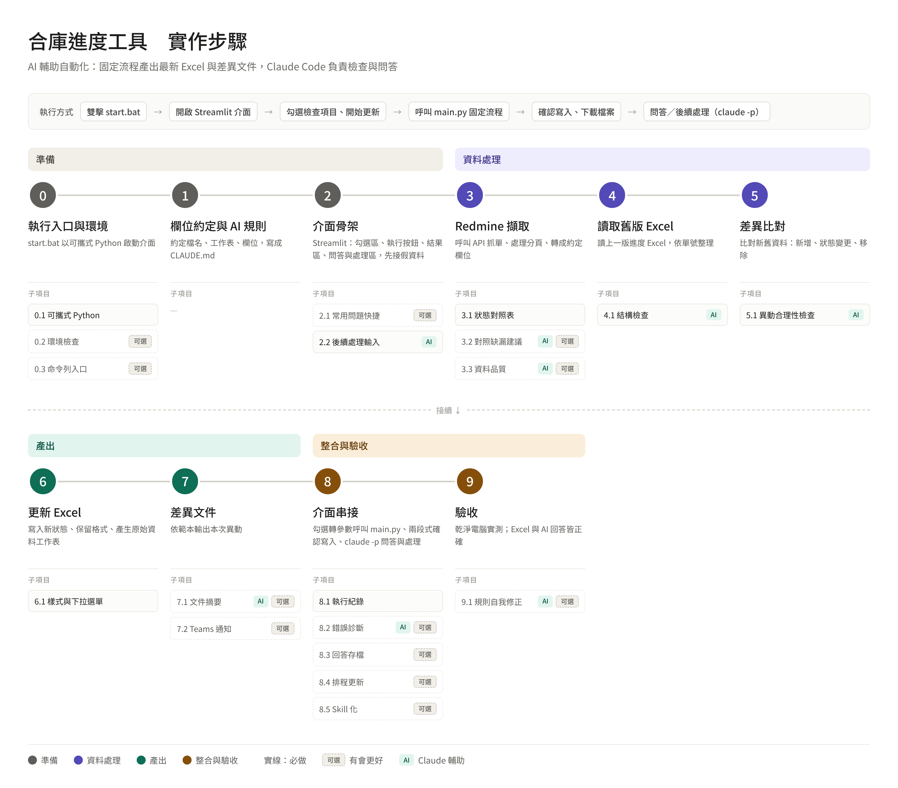

# redmine-excel-sync

自動將 Redmine 單的最新狀態同步到進度 Excel，產出制式差異文件，並可透過 Claude Code 對最新進度提問。

> 內部流程優化工具，僅在公司自有環境使用。


## 實作步驟



### 待辦事項

> 標示「（可選）」者可視需要略過，其餘為必要項目；標示「AI」者需安裝 Claude Code，未安裝時自動略過。

#### 0. 執行入口與環境

- [x] 建立 `start.bat`：切換至專案目錄、設定 UTF-8 編碼（`chcp 65001`）
- [x] 0.1 可攜式 Python
  - [x] 撰寫打包腳本（`scripts/build_portable.ps1`），下載 embeddable Python 並解壓至 `python/`
  - [x] 啟用 `site-packages`（修改 `python*._pth`）並安裝 pip
  - [x] 依 `requirements.txt` 安裝套件至可攜式環境，固定版本
  - [x] `start.bat` 優先使用 `python\python.exe`，找不到時退回系統 Python
  - [x] 確認 `python/` 是否納入版控或另行發布（`.gitignore` 設定）
- [ ] 0.2 環境檢查（可選）
  - [ ] 檢查 Python 與必要套件可正常匯入
  - [ ] 檢查設定檔是否存在、Redmine 金鑰是否已填寫
  - [x] 檢查 Claude Code 是否安裝並已登入，未安裝或未登入時停用 AI 項目
  - [ ] 任一必要項目失敗時顯示中文說明並中止

#### 1. 欄位約定與 AI 規則

- [ ] 約定進度 Excel 檔名規則（含日期，例如 `進度_YYYYMMDD.xlsx`）與存放位置
- [ ] 約定主工作表名稱與「原始資料」工作表名稱
- [ ] 約定欄位：單號、主旨、狀態、負責人、完成率、預計完成日（欄位名稱、型別、格式）
- [ ] 約定單號為唯一鍵，以及日期、百分比的格式
- [ ] 建立設定檔：Redmine 網址、API 金鑰、查詢條件（專案、追蹤標籤、篩選）、`status_mapping`
- [ ] 金鑰不寫死於程式，設定檔加入 `.gitignore`，另提供範例檔
- [ ] 撰寫 `CLAUDE.md`
  - [ ] 資料位置：取 `output/` 中檔名日期最新的進度檔，只讀「原始資料」工作表
  - [ ] 讀取方式：一律以 pandas 篩選統計，不目測計數
  - [ ] 欄位說明與判斷規則（「剩下」、「逾期」等定義）
  - [ ] 判斷不出來時：先說明採用的假設再回答
  - [ ] 禁止 AI 直接修改 Excel 與設定檔
- [ ] 準備測試用的範例進度 Excel

#### 2. Redmine 擷取

- [ ] 以 API 金鑰呼叫 Redmine REST API（`/issues.json`）
- [ ] 處理分頁（`offset` / `limit`），確保抓到全部單
- [ ] 依設定套用查詢條件（專案、狀態含已結案 `status_id=*` 等）
- [ ] 轉換為統一欄位格式（單號、主旨、狀態、負責人、完成率、預計完成日）
- [ ] 處理空值（無負責人、無預計完成日）
- [ ] 錯誤處理：連線逾時、金鑰錯誤（401）、權限不足（403）、網址錯誤，並給出中文說明
- [ ] 2.1 狀態對照表（可選）
  - [ ] 將 Redmine 狀態對應為 Excel 使用的狀態名稱（`status_mapping`）
  - [ ] 不在對照表中的狀態不寫入，記錄於 log 等待人工處理
- [ ] 2.2 對照缺漏建議（可選，AI）
  - [ ] 將缺漏狀態交給 Claude，產出建議對照的報告，不直接修改設定檔
- [ ] 2.3 資料品質檢查（可選，AI）
  - [ ] 檢查缺負責人、缺預計完成日、完成率與狀態矛盾（如已結案但非 100%）等，產出報告

#### 3. 讀取舊版 Excel

- [ ] 從 `output/` 找出檔名日期最新的進度檔作為上一版
- [ ] 找不到舊版時視為首次執行（全部為新增）
- [ ] 依單號整理為「單號 → 資料」對照，並記錄每筆所在列號（供回寫用）
- [ ] 處理單號格式不一（`#123`、數字、文字）
- [ ] 偵測重複單號並提示
- [ ] 檔案被開啟鎖住時，提示先關閉 Excel
- [ ] 3.1 結構檢查（可選，AI）
  - [ ] 檢查工作表與欄位是否符合約定（缺欄、改名、順序變動），產出報告

#### 4. 差異比對

- [ ] 新增：Redmine 有、Excel 沒有
- [ ] 狀態變更：兩邊都有但狀態不同（記錄舊值 → 新值）
- [ ] 移除：Excel 有、Redmine 沒有（只標示不刪除）
- [ ] 視需要比對其他欄位變更（負責人、完成率、預計完成日）
- [ ] 產出結構化的差異結果，供更新 Excel 與差異文件共用
- [ ] 無任何差異時顯示「本次無異動」
- [ ] 4.1 異動合理性檢查（可選，AI）
  - [ ] 檢查可疑異動（狀態倒退、已結案又重開、一次大量變更等），產出報告

#### 5. 更新 Excel

- [ ] 複製上一版另存為新檔（檔名帶當日日期），不覆蓋舊檔
- [ ] 只修改儲存格的值，保留原有文字顏色、背景與格式
- [ ] 寫入狀態變更
- [ ] 新增列附加於表格末端
- [ ] 移除的單以標記方式處理（不刪列）
- [ ] 產生／覆寫「原始資料」工作表（Redmine 最新完整資料，供 AI 讀取）
- [ ] 寫入失敗時不留下半成品檔案
- [ ] 5.1 樣式與下拉選單（可選）
  - [ ] 新增列複製上一列樣式
  - [ ] 保留資料驗證（下拉選單）並延伸至新增列
  - [ ] 異動儲存格加上醒目標示

#### 6. 差異文件

- [ ] 準備差異文件範本（格式：Word / Excel / Markdown 擇一）
- [ ] 依範本輸出本次異動：執行日期、新增、狀態變更、移除、各類筆數統計
- [ ] 檔名帶日期，輸出至 `output/`
- [ ] 6.1 文件摘要（可選，AI）
  - [ ] 由 Claude 依差異結果撰寫重點摘要，附於文件開頭
- [ ] 6.2 Teams 通知（可選）
  - [ ] 以 Webhook 發送異動摘要至 Teams 頻道
  - [ ] Webhook 網址放入設定檔，發送失敗不影響主流程

#### 7. 完成執行入口

- [ ] 串接步驟 2～6 為完整流程
- [ ] 任一步驟失敗時中止並顯示原因，不產生不完整結果
- [ ] 暫停確認點：比對完成後列出異動，確認後才寫入 Excel
- [ ] 流程完成後進入連續問答（呼叫 Claude Code，每題為獨立提問），輸入空白或指定指令結束
- [ ] 未安裝 Claude Code 時自動略過 AI 步驟與問答
- [ ] 提供命令列入口（`progress-cli.bat`）
- [ ] 7.1 執行紀錄（可選）
  - [ ] 每次執行寫入 log（時間、各步驟結果、筆數、錯誤），並定期清理舊 log
- [ ] 7.2 錯誤診斷（可選，AI）
  - [ ] 失敗時將錯誤訊息與 log 交給 Claude，產出可能原因與處理建議
- [ ] 7.3 Streamlit 介面（可選）
  - [ ] `app.py` 提供一鍵執行、顯示進度與異動結果、下載產出檔
  - [ ] 介面內問答
  - [ ] `start.bat` 啟動介面，略過首次 Email 詢問；啟動失敗時提示改用 `progress-cli.bat`
- [ ] 7.4 常用問題快捷（可選）
  - [ ] 預設常用問題（剩餘項目、逾期單、個人未結案、狀態退回）一鍵提問
- [ ] 7.5 回答存檔（可選）
  - [ ] 問答紀錄保存至 `history/`（含時間、問題、回答）
- [ ] 7.6 排程更新（可選）
  - [ ] 以 Windows 工作排程器定時執行固定流程（不含 AI 步驟與問答、不暫停確認）
  - [ ] 提供排程建立說明或腳本
- [ ] 7.7 Skill 化（可選）
  - [ ] 將同步與問答流程包裝為 Claude Code Skill

#### 8. 驗收

- [ ] 在乾淨電腦（未裝 Python）解壓即可執行
- [ ] 驗證 Excel：新增、狀態變更、移除皆正確，格式與下拉選單保留
- [ ] 驗證差異文件內容與實際異動一致
- [ ] 驗證 AI 回答：以範例問題對照手動統計結果
- [ ] 驗證異常情境：金鑰錯誤、網路中斷、Excel 被鎖住、未安裝 Claude Code、首次執行無舊檔
- [ ] 補齊 README 的「資料夾結構」、「常見問題」、「版控注意」章節
- [ ] 8.1 規則自我修正（可選，AI）
  - [ ] AI 回答錯誤時，由 Claude 分析原因並建議 `CLAUDE.md` 規則修改，經人確認後套用

---

## 解決什麼問題

SA 每次更新進度 Excel，都要逐筆對照 Redmine 單的狀態，耗時又容易漏。
本工具把這段工作自動化：

1. 從 Redmine 抓取最新單狀態
2. 與上一版進度 Excel 比對
3. 更新 Excel 並另存新版
4. 產出制式差異文件（本次異動了什麼）
5. （可選）由 Claude Code 檢查異常、回答進度問題

---

## 架構

```
【固定流程】不使用 AI，每次結果一致
Redmine → 擷取 → 比對 → 更新 Excel（含「原始資料」工作表）→ 產差異文件

【AI 輔助】需安裝 Claude Code，未安裝時自動略過
・流程中：結構檢查、異動合理性檢查等，只產報告、不直接改檔
・流程後：讀取最新 Excel，回答「目前還剩哪些項目？」等問題
```

原則：**程式負責偵測、Claude 負責解讀與建議、人負責決定。**

---

## 資料夾結構

---

## 使用前準備

| 項目 | 必要 | 說明 |
|---|---|---|
| 本專案資料夾 | 是 | 含可攜式 Python，不需另外安裝 Python 或套件 |
| Redmine 存取金鑰 | 是 | Redmine → 我的帳戶 → API 存取金鑰 |
| Microsoft Excel | 否 | 僅用於開啟結果，程式不依賴 Excel |
| Claude Code | 否 | 使用 AI 檢查與問答時需要，請用**自己的帳號**登入 |

---

## 使用方式

- 問答紀錄會保存在本機 history 資料夾，每題皆為獨立提問

### 問答範例

- 目前還剩哪些項目？
- 哪些單已經逾期？
- 王小明手上還有幾張未結案？
- 這次有哪些單狀態退回？

> 每題由 Claude Code 依 `CLAUDE.md` 的規則，以程式讀取最新 Excel 的「原始資料」工作表回答。

---

## 設定說明


### `CLAUDE.md`

定義 AI 讀取資料的方式與判斷規則，也是固定流程與 AI 之間**唯一的正式約定**：

- 資料位置：取 `output/` 中檔名日期最新的進度檔，只讀「原始資料」工作表
- 讀取方式：一律以 pandas 篩選統計，不目測計數
- 欄位說明：單號、主旨、狀態、負責人、完成率、預計完成日
- 判斷規則：「剩下」= 狀態不是已結案；「逾期」= 預計完成日早於今天且未結案
- 判斷不出來時：先說明採用的假設再回答

> 修改「原始資料」工作表欄位時，**必須同步更新 `CLAUDE.md`**。

---

## 注意事項

- **執行前請關閉進度 Excel**，否則檔案被鎖住無法寫入
- 程式只修改儲存格的值，原有的文字顏色、背景、下拉選單會保留；新增列會複製上一列樣式
- Redmine 狀態若不在 `status_mapping` 中，**不會寫入**，會記錄在 log 等待人工處理
- AI 檢查只產出報告，**不會直接修改 Excel 或設定檔**
- 排程只執行固定流程，不含 AI 步驟與問答

---

## 常見問題

## 版控注意

